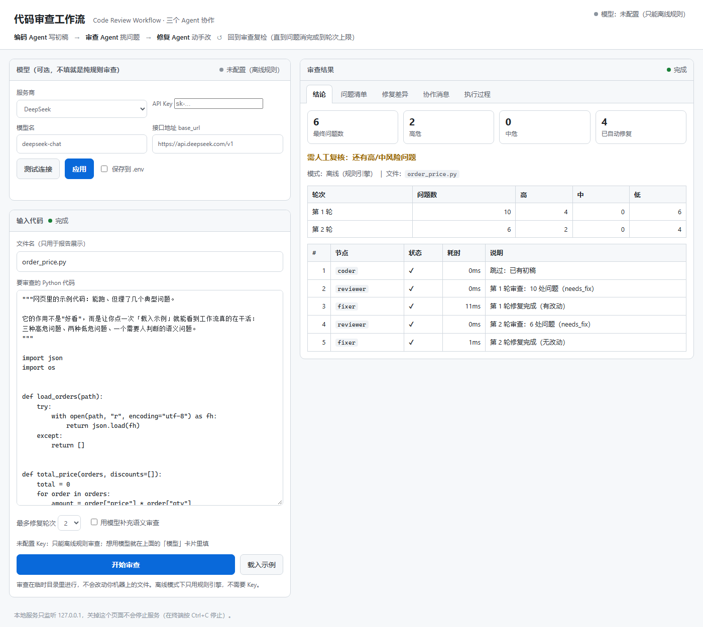
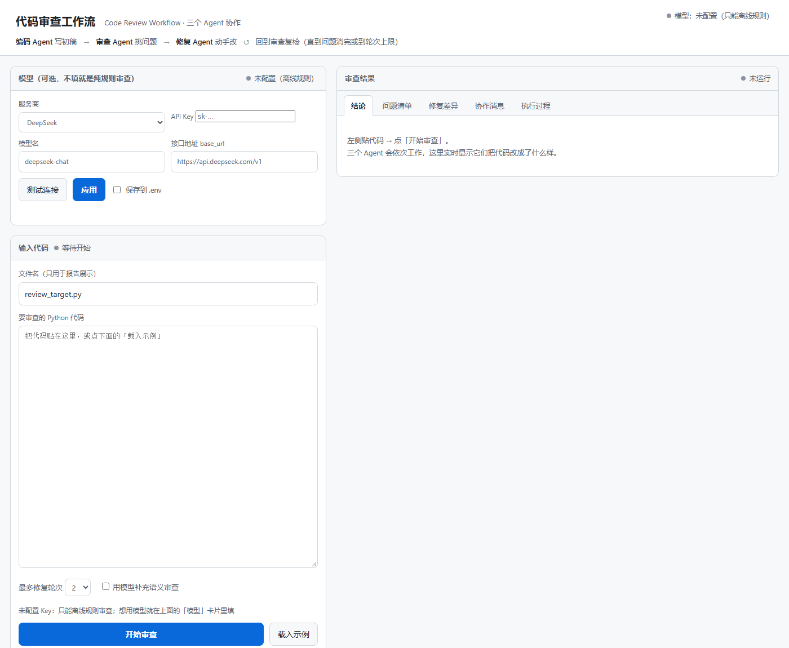

# Code Review Workflow（Simple Workflow MVP）

一个 2–3 个 Agent 协作的代码审查工作流：**编码 Agent → 审查 Agent → 修复 Agent**，修复后自动回到审查环节复检，直到问题消完或达到轮次上限。

- **零第三方依赖**：离线模式纯标准库即可跑完整流程（Python 3.10+）
- **真的会改代码**：修复不是给建议，而是改文件，且每处改动都过语法校验与问题数校验
- **每一步可追溯**：谁在什么轮次、通过什么消息、改了状态里哪个 key，报告里逐条列出来
- **可续跑**：每步落 checkpoint，模型超时/程序崩了可以从断点接着跑

设计说明见 [Design.md](Design.md)，一次真实运行的报告见 [docs/sample-report.md](docs/sample-report.md)。

---

## 1. 它长什么样

```
▶ [agent    ] coder  —  按需求规格生成初稿
    ├─▶ reviewer
  [agent    ] reviewer  —  静态规则 + 语义审查，产出问题清单
    ├─▶ fixer   （有高/中风险且未超轮次）
  [agent    ] fixer  —  按审查意见修复代码并复验
    ├─▶ reviewer   （本轮有改动 → 复检）
```

离线跑一次（不需要 API Key）的真实结果：

| 阶段 | 问题总数 | 高 | 中 | 低 |
|------|----------|----|----|----|
| 第 1 轮审查 | 9 | 3 | 0 | 6 |
| 修复 4 处后第 2 轮审查 | 5 | 1 | 0 | 4 |

剩下的 1 处高危是「异常被静默吞掉」——改法取决于业务语义（重抛还是降级），
工具不猜，写进报告标记为需人工。**"少改但改对"比"看起来都修好了"更重要。**

## 2. 快速开始

**Windows 双击即可：**

| 双击 | 得到什么 |
|------|----------|
| `start-web.bat` | 本地网页（`http://127.0.0.1:8765`）：贴代码 → 点「开始审查」→ 实时看三个 Agent 轮流干活 |
| `start.bat` | 命令行跑一遍离线演示，然后打开 HTML 报告 |



命令行方式（不需要装任何依赖）：

```bash
git clone https://github.com/lingrui0202/code-review-workflow.git
cd code-review-workflow

# 什么都不用装，直接跑（内置需求 + 内置初稿模板）
python main.py run --offline
```

跑完会在 `runs/<run_id>/` 下得到：

| 文件 | 内容 |
|------|------|
| `report.html` | **浏览器直接打开的报告**（双击就能看，无需 Markdown 阅读器） |
| `report.md` | 同一份报告的 Markdown 版（适合贴进文档/仓库） |
| `trace.json` | 每一步的机器可读记录（含状态变更、耗时、消息） |
| `messages.json` | Agent 之间的全部消息 |
| `state.json` | 最终黑板的完整快照 |
| `diff.patch` | 初稿与终稿的 unified diff |
| `final_code.py` | 终稿代码 |
| `checkpoint.json` | 断点，可 `resume` 续跑 |

其他常用命令：

```bash
# 审查一个已有文件（会写回，原件留 .bak）
python main.py run --offline --code examples/bad_module.py

# 只出意见、不改文件
python main.py run --offline --code examples/bad_module.py --no-write

# 接真实模型（编码/审查/修复都由模型参与）
export DEEPSEEK_API_KEY=sk-xxx
python main.py run --task examples/task_order.md --provider deepseek

# 只看流程图 / 规则清单
python main.py graph
python main.py rules

# 从断点续跑
python main.py resume --checkpoint runs/<run_id>/checkpoint.json --offline
```

两个演示脚本：

```bash
python scripts/demo.py          # 离线跑两个场景，产出两份报告
python examples/custom_node.py  # 演示加一个"运行验证"节点
```

### 接模型（可选，不接也能跑）

两种方式，效果一样，任选其一。

**方式 A：网页上的「模型」卡片（推荐，不用改文件）**



- 服务商下拉：DeepSeek / 通义千问 / OpenAI / Moonshot / 本地 Ollama / **自定义（任意 OpenAI 兼容接口）**；
- 选「自定义」时自己填 `base_url`（例：`https://api.example.com/v1`）和模型名，中转站、自建网关都能接；
- 「测试连接」会真的发一个极小的请求，告诉你成功（含延迟、模型回复）或失败在哪一步（缺 Key / 401 / 网络 / 超时）；
- **Key 只留在本机服务进程内存里**，接口只返回 `sk-1***23` 这种掩码；勾了「保存到 .env」才会写磁盘。

**方式 B：手写 `.env`（命令行用）**

1. 在项目根目录把 `.env.example` 复制成 `.env`；
2. 填一行 `DEEPSEEK_API_KEY=sk-...`（换厂商改 `PROVIDER`，变量名见 `.env.example`）；
3. 命令行去掉 `--offline` 即可。

优先级：命令行参数 > 环境变量 > `.env`。没配 Key 时网页上显示「模型：未配置（只能离线规则）」，勾选"用模型"会被拦下并告诉你去哪配。

> 为什么没 Key 也能跑？"挑毛病"里最确定的那部分（裸 `except`、可变默认参数、`== None`、`eval`、异常被吞……）是 Python 的 AST 直接算出来的，不需要模型；修复也只改"改法唯一"的地方。模型只负责补充语义层面的判断——这是可选项，不是前置条件。

## 3. 四种使用方式

| 方式 | 命令 / 代码 | 适用场景 |
|------|-------------|----------|
| 网页界面 | `python main.py web` | 贴代码就看结果，左上方卡片可直接换模型/填 Key |
| 命令行 | `python main.py run ...` | 日常审查、批量处理 |
| 当作库 | `build_review_workflow(provider, workspace)` | 嵌进自己的工具链 / Web 服务 |
| 单个组件 | `review.rules.analyze(source)` | 只要静态检查，不要工作流 |

```python
from workflow_mvp.pipelines import build_review_workflow, initial_state
from workflow_mvp.workflow.engine import EngineConfig, WorkflowEngine
from workflow_mvp.workspace import Workspace
from workflow_mvp.llm.offline import OfflineProvider

workspace = Workspace(".")
graph = build_review_workflow(OfflineProvider(), workspace)
engine = WorkflowEngine(graph, initial_state(task="...", workspace=workspace),
                        config=EngineConfig(run_root="runs"))
result = engine.run()
print(result.status, result.state.get("findings"))
```

## 4. 工作流是怎么组织的

四个核心概念各对应一个模块，互相之间只通过数据契约耦合：

| 概念 | 模块 | 职责 | 关键 API |
|------|------|------|----------|
| **状态（黑板）** | `workflow/state.py` | 所有中间产物，可序列化、可回滚、带审计日志 | `get/set/append/bump`、`snapshot/restore`、`diff` |
| **消息** | `workflow/message.py`·`bus.py` | Agent 间显式交接，带因果链 | `Message.result/feedback/verdict`、`bus.send/latest/drain` |
| **节点** | `workflow/node.py` | 一次"交棒"，输入上下文、输出 patch+消息 | `Node.run(ctx) -> NodeResult` |
| **编排** | `workflow/graph.py`·`engine.py` | 顺序推进、条件分支、回边循环、失败重试 | `Graph.add_edge(when=...)`、`WorkflowEngine.run()` |

节点只依赖抽象，所以：

- 换顺序 = 改 `pipelines.py` 里的两条边；
- 加节点 = `graph.add_node(...)` + 一条边（见 [examples/custom_node.py](examples/custom_node.py)）；
- 把项目 1 的 Agent 接进来 = 实现一个 `act()`（见第 7 节）。

## 5. 命令行参数

| 参数 | 说明 |
|------|------|
| `--task FILE` | 需求规格文件，编码 Agent 据此生成初稿 |
| `--code FILE` | 直接审查已有文件（编码节点自动跳过） |
| `--offline` | 离线模式：只用规则引擎，不调模型 |
| `--provider` | `deepseek` / `qwen` / `openai` / `moonshot` / `ollama` / `offline` |
| `--model` `--api-key` `--base-url` | 覆盖模型、密钥、端点 |
| `--workspace DIR` | 工作区根目录（所有读写都被限制在里面） |
| `--output DIR` | 运行产物目录，默认 `<workspace>/runs` |
| `--max-rounds N` | 最多修复轮次，默认 3 |
| `--max-steps N` | 引擎总步数保护，默认 40 |
| `--no-write` | 不写回原文件，另存 `<name>.fixed.py` |
| `--no-checkpoint` | 不写 checkpoint |
| `--quiet` | 只输出关键步骤 |

## 6. 审查规则

| 规则 | 严重度 | 可自动修复 | 说明 |
|------|--------|-----------|------|
| `bare-except` | 高 | ✅ | 裸 `except:` 会吞掉 KeyboardInterrupt |
| `swallowed-exception` | 高 | — | 捕获后只有 `pass` |
| `mutable-default` | 高 | ✅ | `def f(x=[])` 的跨调用共享问题 |
| `dangerous-call` | 高 | — | `eval` / `exec` / `os.system` / `shell=True` |
| `hardcoded-secret` | 高 | — | 密钥被写进代码 |
| `long-function` | 中 | — | 函数超过 60 行 |
| `deep-nesting` | 中 | — | 控制流嵌套超过 4 层 |
| `too-many-args` | 中 | — | 参数超过 5 个 |
| `syntax-error` | 高 | — | 文件无法解析 |
| `unused-import` | 低 | ✅ | 导入了但没用 |
| `eq-none` | 低 | ✅ | `== None` |
| `missing-docstring` | 低 | — | 公开函数/类缺文档字符串 |

规则全部基于 AST，不依赖模型：结果可复现、可单测（`tests/test_rules.py`）。

## 7. 复用项目 1（Code Agent）的经验

项目 1 是 `code-explain-agent`：单 Agent + ReAct 循环 + 工具层。这一版把它拆成了三种角色，并保留了最有价值的几处设计。

| 项目 1 | 本项目 | 变化 |
|--------|--------|------|
| `LLMProvider` 抽象 + OpenAI 兼容接入 | `llm/` | 去掉 `openai` SDK，改用标准库 `urllib` + 退避重试（依赖从 4 个降到 0 个） |
| 离线规则规划器 `--offline` | `OfflineProvider` + 确定性 Agent | 离线从"兜底"升级为"可交付的完整路径" |
| 工具层（`read_file` / `code_outline` / `code_metrics`） | `workspace.py` + `review/rules.py` | 工具调用变成节点的确定性步骤；AST 分析从"报告指标"变成"判定规则" |
| `ContextMemory` 滑动窗口 | 共享黑板 + 消息总线 + checkpoint | 从"单个 Agent 记对话"变成"多个 Agent 记状态"，且能落盘续跑 |
| 单 Agent 一次问答 | 图编排 + 条件边 + 回边 | 真正把"谁交给谁"显式化 |
| `main.py` + `src/` + `scripts/package.py` + `unittest` | 同左 | 保持一致的工程约定，评测方不用重新学一套 |

**把项目 1 的 Agent 作为本工作流的节点**，只需一个适配器：

```python
from workflow_mvp.agents.base import AgentNode, AgentResult, BaseAgent

class CodeExplainAdapter(BaseAgent):
    role = "explain"

    def act(self, ctx):
        from workflow_mvp.llm.factory import create_provider   # 项目 1 的 Agent 也可以自带 provider
        answer = my_hw1_agent.run(ctx.state.get("code"))        # 项目 1 的入口
        return AgentResult(patch={"explanation": answer},
                           note="代码解释完成")

graph.add_node(AgentNode(CodeExplainAdapter("explainer", provider=provider, workspace=ws)))
```

Agent 不关心前后是谁，只关心 `state` 里有什么、要写回什么——这正是让它可被替换的原因。

## 8. 项目结构

```
code-review-workflow/
├── main.py                         统一入口（薄壳，只有 20 行）
├── start.bat                       Windows 双击即跑：命令行演示 + 打开 HTML 报告
├── start-web.bat                   Windows 双击即开网页版
├── requirements.txt                零依赖说明
├── pyproject.toml
├── .env.example
├── README.md
├── Design.md                       设计文档
├── docs/sample-report.md           一次真实离线运行的报告
├── examples/
│   ├── task_order.md               需求规格示例
│   ├── bad_module.py               "看起来能跑、其实有坑"的示例代码
│   └── custom_node.py              扩展示例：加一个运行验证节点
├── scripts/
│   ├── demo.py                     一键演示（两个场景）
│   └── package.py                  跑测试 + 打 zip
├── tests/                          107 项单元测试
└── src/workflow_mvp/
    ├── config.py                   配置（.env / 环境变量 / CLI）
    ├── cli.py                      命令行
    ├── pipelines.py                主流程装配（节点 + 边 + 条件）
    ├── report.py                   报告与产物生成
    ├── html_report.py              报告转自包含 HTML（无 Markdown 阅读器也能看）
    ├── webui.py                    本地网页服务（http.server，只用标准库）
    ├── model_settings.py           模型设置：换厂商/地址/Key、掩码、测试连接、写 .env
    ├── workspace.py                唯一文件出入口（越权防护 / 备份 / 原子写）
    ├── workflow/
    │   ├── state.py                黑板
    │   ├── message.py              消息信封
    │   ├── bus.py                  消息总线
    │   ├── node.py                 节点抽象
    │   ├── graph.py                图与条件边
    │   ├── engine.py               执行引擎
    │   └── checkpoint.py           断点存取
    ├── agents/
    │   ├── base.py                 Agent 基类 + AgentNode 适配
    │   ├── coder.py                编码 Agent
    │   ├── reviewer.py             审查 Agent
    │   ├── fixer.py                修复 Agent
    │   ├── prompts.py              Prompt 模板
    │   └── __init__.py             注册表（按名字建 Agent）
    ├── review/
    │   ├── finding.py              Finding / Rule 数据结构
    │   ├── rules.py                12 条 AST 规则
    │   └── fixes.py                确定性修复器 + 三道校验闸
    ├── llm/
    │   ├── base.py                 抽象 + JSON 提取
    │   ├── openai_compat.py        标准库 HTTP 客户端
    │   ├── offline.py              离线实现
    │   └── factory.py              provider 工厂与预设
    └── data/                       内置需求规格与初稿模板
```

## 9. 测试

```bash
python -m unittest discover -s tests -v
```

107 项，覆盖：

- **状态**：点号路径、快照隔离、回滚、diff、审计日志、序列化
- **消息**：类型校验、投递、因果链、总线统计、序列化
- **图**：悬空边、不可达节点、无条件分支歧义、条件异常降级、环检测
- **引擎**：线性推进、条件分支、失败回滚、重试、循环保护、步数保护、断点续跑
- **规则**：12 条规则逐条正例 + 干净代码零误报 + 部分使用 import
- **修复**：4 类机械修复、幂等性、非法修改回滚、模型重写的三道闸
- **端到端**：离线全流程、跳过编码节点、写回与备份、报告产物、checkpoint
- **网页界面**：服务层跑完整审查、HTTP 端点、查询串路由、4xx 错误体
- **模型设置**：厂商切换、Key 掩码不外泄、自定义接口必填 base_url、.env 只改相关行

## 10. 常见问题

**没有 API Key 能跑吗？为什么？**
能，而且这是设计选择。审查用的 12 条规则基于 Python 的 AST，是算出来的结论，不依赖模型；修复也只做"改法唯一"的机械修改。模型只在勾选/去掉 `--offline` 时参与，用来补充语义问题。所以没有 Key 时你得到的是"确定的、可复现的"结果。

**API Key 填在哪里？**
两个地方都行：网页上的「模型」卡片直接填（只在内存，勾选后写 `.env`），或手写项目根目录的 `.env`。网页顶部会显示当前模型状态；没配时勾选"用模型"会被拦下并给出 `.env` 路径。

**离线模式的"编码 Agent"是不是假的？**
它从内置模板生成一份**明确带缺陷**的初稿，目的是让审查与修复有东西可处理。真实编码请接模型（`--provider`）。这一点在报告和代码注释里都写明了，没有伪装成模型输出。

**会自动改我的文件吗？**
`--code` 模式默认写回，但改之前会备份成 `.bak`；不放心就加 `--no-write`。所有写入都被限制在 `--workspace` 之内。

**修复会不会把代码改坏？**
每处修改都要过三道闸：能 `ast.parse`、目标问题数确实变少、没有新增高危问题，任意一道不过就回滚这一处。模型重写的整份文件过同一套闸，不达标整份丢弃。

**能换成我自己的 Agent 吗？**
可以。实现 `BaseAgent.act()` 即可（第 7 节），或用 `register_agent("kind", Factory)` 注册一个新类型。

## 11. 已知局限

1. 规则面向 Python（AST），其它语言只能做文本级检查；
2. 修复只覆盖"改法唯一"的问题，语义类问题一律留人工；
3. 顺序执行，没有并行分支（`Graph` 已支持多条件边，但引擎一次只走一条）；
4. 网页版一次只审一个文件、且不做历史记录持久化（每次审查在临时目录里，关掉就没了）；
5. 模型的语义审查偶尔会给出规则不认识的 `rule` 名，报告里会原样展示但不参与自动修复。
