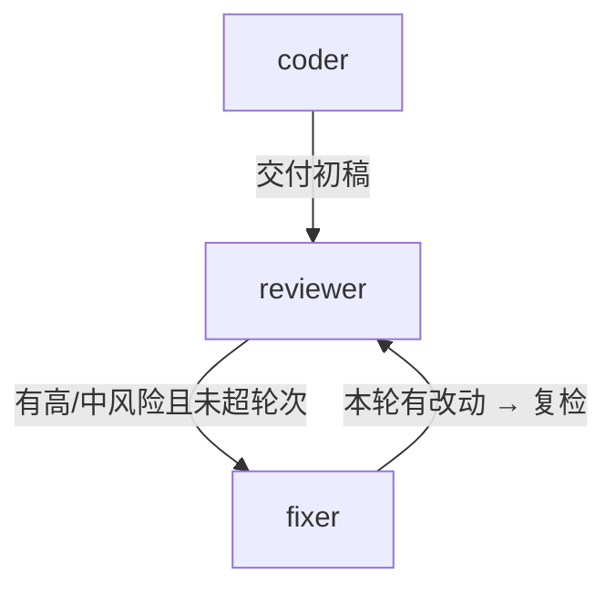

# 代码审查与修复工作流 · 运行报告

> run_id：`20261021-192426-eb22` ｜ 状态：**完成** ｜ 耗时：24ms（5 步） ｜ 结束原因：没有后续节点，流程正常结束

## 1. 结论

| 指标 | 数值 |
|------|------|
| 初始问题 | 9 处（高 3 / 中 0 / 低 6） |
| 最终问题 | 5 处（高 1 / 中 0 / 低 4） |
| 审查轮次 | 2 |
| 自动修复 | 4 处 |
| 跳过/需人工 | 0 处 |
| 最终裁决 | **需人工复核** |

审查发现的 4 处问题已被自动修复消除，剩余部分按严重度列在下方。

## 2. 工作流结构

```text
▶ [agent    ] coder  —  按需求规格生成初稿
    ├─▶ reviewer   （交付初稿）
  [agent    ] reviewer  —  静态规则 + 语义审查，产出问题清单
    ├─▶ fixer   （有高/中风险且未超轮次）
  [agent    ] fixer  —  按审查意见修复代码并复验
    ├─▶ reviewer   （本轮有改动 → 复检）
```



## 3. 执行时间线

| # | 节点 | 状态 | 轮次 | 耗时 | 说明 | 状态变更 |
|---|------|------|------|------|------|----------|
| 1 | `coder` | ok | 1 | 5ms | 生成初稿 65 行 | `code`、`code_history`、`code_origin`、`code_path`、`task_spec` |
| 2 | `reviewer` | ok | 1 | 1ms | 第 1 轮审查：9 处问题（needs_fix） | `findings`、`findings_fingerprint`、`findings_history`、`review… |
| 3 | `fixer` | ok | 1 | 15ms | 第 1 轮修复完成（有改动） | `code`、`code_history`、`fix_log`、`fix_origin`、`fix_summary`、`… |
| 4 | `reviewer` | ok | 2 | 1ms | 第 2 轮审查：5 处问题（needs_fix） | `findings`、`findings_fingerprint`、`findings_history`、`review… |
| 5 | `fixer` | ok | 2 | 2ms | 第 2 轮修复完成（无改动） | `code_history`、`fix_summary`、`last_progress`、`manual_todo` |

## 4. 每轮审查结果

| 轮次 | 问题总数 | 高 | 中 | 低 | 裁决 |
|------|----------|----|----|----|------|
| 第 1 轮 | 9 | 3 | 0 | 6 | needs_fix |
| 第 2 轮 | 5 | 1 | 0 | 4 | needs_fix |

## 5. Agent 协作记录

| 轮次 | 类型 | 发送方 → 接收方 | 内容摘要 |
|------|------|------------------|----------|
| 1 | `result` | coder → reviewer | 初稿已生成：output/draft.py，共 65 行；自检发现 9 处规则问题，请审查。 |
| 1 | `result` | reviewer → fixer | 第 1 轮审查完成：高 3 / 中 0 / 低 6，请修复可自动处理的部分。 |
| 1 | `feedback` | fixer → reviewer | 第 1 轮修复完成：改 4 处，新增 5 行 / 删除 4 行，请复检。 |
| 2 | `result` | reviewer → fixer | 第 2 轮审查完成：高 1 / 中 0 / 低 4，请修复可自动处理的部分。 |
| 2 | `verdict` | fixer → * | 第 2 轮无可自动修复的问题，剩余 5 处需要人工判断。 |

共 5 条消息：result 3，feedback 1，verdict 1

## 6. 自动修复明细

| 轮次 | 规则 | 位置 | 结果 | 说明 |
|------|------|------|------|------|
| 1 | `bare-except` | L36 | ✅ 已改 | 已自动修改 |
| 1 | `eq-none` | L21 | ✅ 已改 | 已自动修改 |
| 1 | `mutable-default` | L17 `calc_total` | ✅ 已改 | 已自动修改 |
| 1 | `unused-import` | L14 `os` | ✅ 已改 | 已自动修改 |

## 7. 遗留问题（需人工处理）

| 严重度 | 规则 | 位置 | 问题 | 建议 |
|--------|------|------|------|------|
| 高 | `swallowed-exception` | L45 | except Exception 之后只有 pass，异常被静默吞掉 | 至少记录日志，或把异常重新抛出；确实要忽略时写一句注释说明原因。 |

这些问题的改法依赖业务语义（比如异常该重抛还是该降级、函数该拆成哪几块），
工具不做猜测，留给人工判断。

（修复阶段标记为需人工的问题共 1 条，已包含在上表中。）

## 8. 代码差异

```diff
--- a/output/draft.py
+++ b/output/draft.py
@@ -11,14 +11,15 @@
 from __future__ import annotations
 
 import json
-import os
 
 
-def calc_total(items, discounts=[]):
+def calc_total(items, discounts=None):
+    if discounts is None:
+        discounts = []
     total = 0
     for item in items:
         price = item["price"] * item["qty"]
-        if item.get("category") == None:
+        if item.get("category") is None:
             price = price * 1.0
         total = total + price
     for rule in discounts:
@@ -33,7 +34,7 @@
     try:
         with open(path, "r", encoding="utf-8") as fh:
             return json.load(fh)
-    except:
+    except Exception:
         return []
 
 
```

## 9. 状态快照（关键键）

| key | 值 |
|-----|-----|
| `code_path` | output/draft.py |
| `code_origin` | 内置模板（离线演示） |
| `iterations` | 2 |
| `verdict` | needs_fix |
| `findings_fingerprint` | dc0a0871a2 |
| `max_rounds` | 3 |

运行配置：

| 项 | 值 |
|----|----|
| `provider` | deepseek |
| `model` | (默认) |
| `api_key` | 未设置 |
| `base_url` | (默认) |
| `offline` | True |
| `max_rounds` | 3 |
| `write_back` | True |
| `workspace` | E:\Dev\GitHub\lingrui0202\code-review-workflow\dem… |

---

报告由 `python main.py run` 自动生成；同一目录下的 `trace.json` / `messages.json` / `diff.patch` 是同一份数据的机器可读版本。